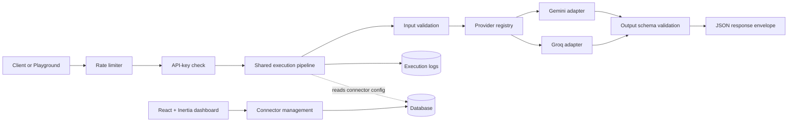

# Universal AI API Connector

A configuration-driven platform that turns AI prompts into reusable HTTP APIs. Define a connector's provider, model, instructions, input fields, and JSON output schema in the dashboard; the shared execution pipeline validates requests, calls the AI provider, validates the response, and records usage.

**Live application:** https://universal-ai-api-connector-production.up.railway.app  
**Dashboard:** https://universal-ai-api-connector-production.up.railway.app/connectors  
**Health check:** https://universal-ai-api-connector-production.up.railway.app/health  
**Repository:** https://github.com/sarveshsantoshmhatre/Universal-AI-API-Connector

> Provider credentials must be configured on the server. Never commit API keys or put them in frontend code.

## Highlights

- **Configuration-driven connectors:** create and manage AI endpoints from the UI without writing a new route for each connector.
- **Multiple providers:** provider adapters for Google Gemini and Groq behind a common interface.
- **Structured output:** define a JSON Schema and validate model output before returning it to the caller.
- **Dynamic playground:** test connectors with generated input forms, example inputs, response/error details, latency and token usage.
- **Generated API docs:** endpoint details, request fields, authentication, cURL and language examples, response formats, limits and error codes.
- **Execution history and metrics:** persistent logs for successful and failed calls, latency, token usage, provider/model and error codes.
- **Per-connector API keys:** issue, scope and revoke keys; store hashes rather than plaintext; display a newly issued key only once.
- **Request protection:** input validation, upload/text limits, API-key enforcement and rate limiting.
- **Reusable templates and sample assets:** demo connectors and sample inputs for quick evaluation.
- **Responsive dashboard:** clean interface with light/dark themes, search/filtering, success-rate visualization and execution history.
- **UI polish:** ocean-teal/aqua visual direction, restrained shadows and gradients, and subtle CSS-based 3D depth on the connector dashboard with reduced-motion support.
- **Deploy-friendly startup:** database migrations and seeded demo connectors are applied at boot.

## Demo connectors

The application seeds example connectors so the platform can be explored immediately.

| Connector | Example use | Provider / model | Input | Output |
| --- | --- | --- | --- | --- |
| Business Card Scanner | Extract contact details from a card image | Gemini | `card_image` | Name, company, designation, phone, email, website |
| Invoice Scanner | Extract invoice fields from an image | Gemini | `invoice_image` | Vendor, invoice number/date, due date, currency, totals |
| Article Writer | Generate a structured article | Groq | `topic` | Title, body |
| Content Rewriter | Rewrite text to given instructions | Groq | `text`, `instructions` | Rewritten text, change list |
| Support Ticket Classifier | Classify and summarize a support request | Groq | `ticket_text`, `customer_tier` | Category, urgency, sentiment, summary, issues, suggested reply |

The exact connector definitions and model identifiers are controlled by the current seeder and application configuration.

## Try it

1. Open the [connector dashboard](https://universal-ai-api-connector-production.up.railway.app/connectors).
2. Choose a demo connector and open its playground.
3. Use the sample input if available, then run a test.
4. Review the JSON response, latency, token usage and execution log.
5. Open the connector's generated documentation for its API contract and example requests.

For connectors configured to require a key, create a key in the dashboard and send it as a bearer token or the documented API-key header. Treat the plaintext key as a secret; it is not shown again after creation.

## How it works



### Core design

- **One route, many connectors:** the shared endpoint `POST /api/connectors/{slug}` executes connectors from database configuration rather than generated source files.
- **Provider adapters:** implementations conform to a shared provider contract and are resolved through a registry.
- **Server-side secrets:** provider keys are read from environment configuration and are not sent to the browser.
- **Validate both sides:** incoming fields are normalized and checked; provider output is parsed and checked against the configured JSON Schema before it is returned.
- **Consistent responses:** success and failure responses use a predictable JSON envelope with stable error codes.
- **Traceable usage:** execution records capture outcomes and available provider timing/token metadata.

## Technology stack

- **Backend:** PHP, Laravel
- **Frontend:** React, TypeScript, Inertia.js, Vite
- **Styling:** CSS with responsive layouts, theme support and reduced-motion handling
- **Database:** PostgreSQL in the deployed environment; Laravel migrations manage schema
- **AI integrations:** Google Gemini and Groq
- **Validation:** JSON Schema validation for structured provider responses
- **Deployment:** Docker-based application deployment on Railway

## API response shape

Successful responses use a common envelope:

```json
{
  "success": true,
  "data": {
    "example": "structured result"
  },
  "error": null,
  "meta": {
    "provider": "provider-name",
    "model": "model-id",
    "duration_ms": 1200,
    "usage": {
      "input_tokens": 100,
      "output_tokens": 50,
      "total_tokens": 150
    }
  }
}
```

Failure responses set `success` to `false`, `data` to `null`, and include an `error` object with a stable code, human-readable message, and optional field details. Token usage fields depend on what the provider returns.

### Common error categories

| HTTP status | Example code | Meaning |
| --- | --- | --- |
| 400 | `INVALID_JSON` | Request body could not be parsed |
| 401 | `UNAUTHORIZED` | Required API key is missing, invalid, revoked or scoped to another connector |
| 403 | `CONNECTOR_NOT_ACTIVE` | Connector is not enabled for execution |
| 404 | `CONNECTOR_NOT_FOUND` | Connector slug does not exist |
| 405 | `METHOD_NOT_ALLOWED` | Unsupported HTTP method |
| 422 | `INPUT_VALIDATION_FAILED` | Input does not match the connector definition |
| 429 | `RATE_LIMITED` | Request limit exceeded |
| 500 | `INTERNAL_ERROR` | Unexpected server-side failure |
| 502 | `PROVIDER_ERROR` / `OUTPUT_SCHEMA_MISMATCH` | Provider failed or returned invalid structured output |
| 503 | `PROVIDER_NOT_CONFIGURED` / `PROVIDER_UNAVAILABLE` | Provider credentials or service are unavailable |
| 504 | `PROVIDER_TIMEOUT` | Provider call timed out |

The connector-specific generated documentation is the source of truth for each endpoint's exact fields, authentication mode and examples.

## Local development

### Requirements

- PHP 8.3 or newer
- Composer
- Node.js 22 or newer
- A database supported by the Laravel configuration (PostgreSQL recommended to match deployment)

### Setup

```bash
git clone https://github.com/sarveshsantoshmhatre/Universal-AI-API-Connector.git
cd Universal-AI-API-Connector

composer setup
```

Configure your local `.env` with database credentials and provider keys, for example:

```dotenv
GEMINI_API_KEY=your_gemini_api_key
GROQ_API_KEY=your_groq_api_key
```

Then seed the demo connectors and start the development environment:

```bash
php artisan db:seed
composer run dev
```

Open the local URL reported by the Laravel development server (commonly http://localhost:8000).

### Useful commands

```bash
php artisan test          # run automated tests
php artisan migrate       # apply database migrations
php artisan db:seed       # seed demo connectors
npm run build             # compile production frontend assets
```

Tests should use fake/stub provider responses where configured so that normal test runs do not consume provider quota.

## Configuration

Keep secrets in environment variables or the deployment platform's secret manager. Never commit a populated `.env` file.

| Variable | Purpose |
| --- | --- |
| `GEMINI_API_KEY` | Google Gemini credentials |
| `GROQ_API_KEY` | Groq credentials |
| `AI_PROVIDER_TIMEOUT_SECONDS` | Provider request timeout |
| `AI_HUB_MAX_UPLOAD_KB` | Maximum accepted upload size |
| `AI_HUB_MAX_TEXT_CHARS` | Maximum text/JSON field length |
| `AI_HUB_RATE_LIMIT_PER_MINUTE` | Per-client request limit |
| `AI_HUB_CONNECTOR_RATE_LIMIT_PER_MINUTE` | Per-connector request limit |

Defaults and supported variables are defined by the current application configuration. Check `.env.example` and `config/ai-hub.php` before changing deployment settings.

## Security notes

- Configure provider credentials only on the server.
- Use per-connector API keys for endpoints that should not be public.
- Keys should be treated as secrets and copied when first issued.
- Uploads and fields are subject to validation and configured limits.
- Rate limits help reduce accidental or abusive traffic.
- The dashboard's authentication/access model should be reviewed before using this evaluation-oriented project with sensitive or production customer data.

## Deployment

The live application is deployed on Railway. The project uses a Docker-based deployment and Laravel migrations. Configure the required database and provider secrets in the Railway service variables, then deploy the intended branch. The `/health` endpoint can be used for a basic health check.

After deployment, verify:
- `/health` returns a healthy status.
- `/connectors` loads and seeded connectors are present.
- Provider secrets are configured without exposing them to the frontend.
- A demo request succeeds and an invalid request returns the expected error envelope.
- Logs are written and rate limits behave as configured.

## Project improvements included

- Refined the visual design with an ocean-teal/aqua theme and a cleaner, more consistent interface.
- Added subtle depth to the connector dashboard using CSS perspective, layered gradients, shadows and hover treatment without adding a 3D rendering dependency.
- Included reduced-motion handling so depth/hover effects are toned down for users who prefer less animation.
- Documented the connector architecture, provider integrations, API contract, local setup, configuration and deployment workflow.

## Known trade-offs

- The available connector definitions and provider/model options depend on application configuration; the model catalogue is not necessarily fetched live from providers.
- Provider capabilities differ; not every provider supports image or file input.
- Token usage is available only when reported by the provider.
- Rate limiting depends on the configured cache backend; multi-instance deployments should use a shared cache.
- Review dashboard access control, monitoring and operational secrets management before using the project for real customer workloads.

## License

No license file is currently documented here. Add a license if you intend to grant others explicit reuse, modification or redistribution rights.
